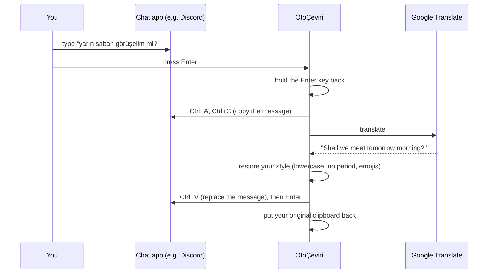

**English** | [Türkçe](README.tr.md)

# OtoÇeviri

**Type in your own language, send in theirs.** OtoÇeviri ("auto-translate" in Turkish) is a small Windows tray app that translates what you type into the language you choose, right inside the app you are typing in: Discord, WhatsApp, Telegram, browser chats, in-game chat and more. It keeps your writing style intact: if you write in lowercase, the translation stays lowercase; if you leave out the final period, none is added; and emojis stay where you put them.

```
You type:     merhaba, bu akşamki toplantıya katılabilecek misin? 🙂
They see:     hello, will you be able to attend the meeting tonight? 🙂
```

## Contents

- [Features](#features)
- [How it works](#how-it-works)
- [Requirements](#requirements)
- [Installation](#installation)
- [Getting started](#getting-started)
- [Using it](#using-it)
- [Style preservation](#style-preservation)
- [Settings](#settings)
- [Hotkeys](#hotkeys)
- [Configuration file](#configuration-file)
- [Privacy and security](#privacy-and-security)
- [Limitations](#limitations)
- [Troubleshooting](#troubleshooting)
- [Project structure](#project-structure)
- [Roadmap](#roadmap)
- [License](#license)
- [Disclaimer](#disclaimer)

## Features

- **Translate on Enter.** Type a message and press Enter. The message is translated and sent in one step.
- **Translate with a hotkey.** Press `Ctrl+Shift+U` to translate the selected text (or the whole text box) in place without sending it.
- **Undo.** Press `Ctrl+Shift+Z` right after a hotkey translation to get your original text back.
- **Keeps your style.** Lowercase, ALL CAPS, missing final periods, emojis and line breaks are preserved.
- **Smart skipping.** Bot commands (`/play ...`), links, emoji-only messages and text that is already in the target language are left alone.
- **13 target languages:** English, German, French, Spanish, Italian, Portuguese, Dutch, Russian, Arabic, Japanese, Korean, Chinese and Turkish. The source language is detected automatically.
- **Turkish and English interface.** By default it follows your Windows display language.
- **Light, dark or system theme.** By default it follows your Windows theme, even when you switch themes while the app is running.
- **Start with Windows** (optional), with no administrator rights needed.
- **Free.** Uses Google Translate's public web endpoint, so you don't need an API key or an account.

## How it works

OtoÇeviri runs in the system tray and listens for exactly two things: the Enter key and its own hotkeys. When one of them is pressed while Auto-Translate is on, it does the following:



Translation usually takes about 0.3 seconds.

## Requirements

- Windows 10 or Windows 11
- Python 3.10 or newer (developed and tested with Python 3.13)
- An internet connection

## Installation

```bash
git clone https://github.com/ysft1rt-art/otoceviri.git
cd otoceviri
pip install -r requirements.txt
```

The dependencies are [`keyboard`](https://pypi.org/project/keyboard/) (global key hooks), [`pyperclip`](https://pypi.org/project/pyperclip/) (clipboard), [`pystray`](https://pypi.org/project/pystray/) (tray icon) and [`Pillow`](https://pypi.org/project/pillow/) (tray icon drawing). The settings window uses Tkinter, which comes with Python.

## Getting started

1. Double-click **`baslat.bat`**. It starts the app without a console window. You can also run `pythonw otoceviri.py` yourself.
2. A small **Ç** icon appears in the tray, next to the clock. If you don't see it, check the hidden icons behind the `^` arrow.
3. Auto-Translate starts **off**: the icon is **gray**. Press **`Ctrl+Shift+Y`** or left-click the icon to turn it on. The icon turns **green** and you hear a short high beep. Turning it off plays a low beep.
4. Right-click the icon to choose the **target language**. English is the default.
5. Open a chat, type in your own language and press Enter.

Only one copy of the app can run at a time. Starting it a second time shows "OtoÇeviri is already running."

## Using it

There are two translation modes. Both are on by default, and you can turn each one on or off under **Translation mode** in the tray menu or in Settings.

### Translate automatically on Enter

Type your message and press **Enter**. OtoÇeviri copies the text box, translates it, replaces the text and presses Enter for you.

- **Shift+Enter** (and Ctrl/Alt/Win+Enter) are never touched, so you can still add new lines.
- If the text doesn't need translating (a command, a link, only emojis, or text that is already in the target language), the message is sent as it is.
- If the text box is empty or can't be copied (password fields, for example), Enter works as usual.
- **If the translation fails** (no internet, for example), the message is **not sent**. You get a notification and an error sound, and your text stays in the box. Press Enter again to retry, or turn Auto-Translate off to send it untranslated.
- Enter mode is **disabled in apps where Enter has a different meaning**: Word, Excel, PowerPoint, OneNote, Notepad, Notepad++, VS Code, Visual Studio, terminals, File Explorer, Windows Search and password managers. You can edit this list in Settings. Hotkey mode still works in these apps.

### Translate with a hotkey

Press **`Ctrl+Shift+U`**:

- If some text is **selected**, only the selection is translated and replaced.
- If **nothing is selected**, the whole text box is translated.
- Nothing is sent, so you can review the result first. This mode works well for longer texts, emails and documents.

### Undo the last translation

Press **`Ctrl+Shift+Z`** right after a hotkey translation to put your original text back.

- To stay safe, OtoÇeviri selects the translated text backwards from the cursor and **checks that it is exactly the translation** before replacing it. If you edited the text or moved the cursor in the meantime, it changes nothing and shows "Couldn't undo: the text has changed".
- Undo works in the **same window** and for **5 minutes** after the translation.
- When there is nothing to undo, `Ctrl+Shift+Z` goes to the app as usual. In many apps it means "redo".
- Messages sent with Enter mode can't be undone, because they are already sent.

### Hotkeys don't leak into other apps

OtoÇeviri's hotkeys are swallowed so the app you're typing in never sees them. For example, `Ctrl+Shift+U` normally opens the file upload dialog in Discord, but it won't while OtoÇeviri uses it. To avoid getting in the way:

- `Ctrl+Shift+Y` (on/off) always belongs to OtoÇeviri.
- `Ctrl+Shift+U` (translate) is only taken while Auto-Translate is on and hotkey mode is enabled.
- `Ctrl+Shift+Z` (undo) is only taken when there is actually something to undo.

## Style preservation

Google Translate capitalizes the first letter and often adds a final period, even when you didn't write one. OtoÇeviri translates the text and then puts your writing habits back. These are real results:

| You write | Plain Google Translate | OtoÇeviri sends |
|---|---|---|
| `yarın sabah görüşelim mi?` | `Shall we meet tomorrow morning?` | `shall we meet tomorrow morning?` |
| `Rapor hazır, inceleyebilirsiniz` | `The report is ready, you can review it.` | `The report is ready, you can review it` |
| `harika bir haber 🎉` | `Great news 🎉` | `great news 🎉` |

The rules:

- **All lowercase** in → all lowercase out (Turkish dotted/dotless i handled correctly). This applies to the whole translation, so in English the pronoun "I" also becomes "i". If you don't want that, start your message with a capital letter.
- **ALL CAPS** in (at least 3 letters) → ALL CAPS out. Google usually does this already; OtoÇeviri makes sure of it.
- **No final punctuation** in → the period Google adds is removed. Question and exclamation marks are kept.
- **Emojis** at the start and end of the message are kept, including skin tones, family emojis and flags. Google usually keeps them too, but sometimes drops one at the end; OtoÇeviri puts it back.
- **Leading/trailing spaces and line breaks** are kept.

Translations can vary slightly from one request to the next, because they come from Google.

## Settings

Right-click the tray icon and choose **Settings…**. Changes take effect as soon as you press **Save**, with no restart needed.

**General**

| Setting | What it does |
|---|---|
| Target language | The language your text is translated into. You can also change it from the tray menu. |
| Interface language | **System** (default), **Türkçe** or **English**. System means Turkish if your Windows display language is Turkish, English otherwise. The tray menu switches right after saving; the Settings window uses the new language the next time you open it. |
| Theme | **System** (default), **Light** or **Dark**. System follows your Windows app theme while the app is running. The theme applies to the Settings window, its title bar and the tray menu. Clicking a theme previews it right away. |
| Turn Auto-Translate on when the app starts | By default the app starts with Auto-Translate off. |
| Start with Windows | Starts OtoÇeviri when you sign in to Windows. It is stored only for your user account (`HKCU\...\Run`), so no administrator rights are needed. If you move the app folder, the stored path fixes itself the next time the app starts. |

**Translation mode** (only one can be selected at a time)

| Setting | What it does |
|---|---|
| Translate with hotkey | Translates the selected text only when you press the hotkey (`Ctrl+Shift+U`). |
| Translate automatically on Enter | Translates and sends the text when you press Enter. |

**Hotkeys**

Click **Change**, then press the new key combination. Press `Esc` to cancel. A hotkey must include **Ctrl, Alt or Win**, because a hotkey like Shift+A would block normal typing. The same hotkey can't be used for two actions.

**Apps where Enter mode is disabled**

One program per line, such as `excel.exe`. `.exe` is added automatically if you leave it out. To find a program's name, open Task Manager, right-click the app and choose **Go to details**.

### About

Right-click the tray icon and choose **About** to see the version number, a link to this GitHub page, the license and the disclaimer. Press `Esc`, `Enter` or **Close** to close it.

## Hotkeys

| Action | Default | When it is active |
|---|---|---|
| Turn Auto-Translate on/off | `Ctrl+Shift+Y` | Always |
| Translate selection / text box | `Ctrl+Shift+U` | Auto-Translate on and hotkey mode enabled |
| Undo last translation | `Ctrl+Shift+Z` | Right after a hotkey translation (same window, within 5 minutes) |
| Translate and send | `Enter` | Auto-Translate on and Enter mode enabled, outside excluded apps |
| New line (never translated) | `Shift+Enter` | Always |

## Configuration file

Settings are stored in **`ayarlar.json`** next to the app. The file is created on first launch and is not tracked by Git. Using the Settings window is the easiest way to change it, but you can also edit it by hand while the app is closed:

| Key | Default | Description |
|---|---|---|
| `hedef_dil` | `"en"` | Target language code: `en`, `de`, `fr`, `es`, `it`, `pt`, `nl`, `ru`, `ar`, `ja`, `ko`, `zh-CN`, `tr` |
| `arayuz_dili` | `"sistem"` | Interface language: `sistem` (system), `tr`, `en` |
| `tema` | `"sistem"` | Theme: `sistem` (system), `acik` (light), `koyu` (dark) |
| `ceviri_modu` | `"enter"` | Translation mode: `enter` (translate on Enter) or `kisayol` (translate with hotkey) |
| `acilista_aktif` | `false` | Turn Auto-Translate on at startup |
| `ac_kapa_kisayolu` | `"ctrl+shift+y"` | On/off hotkey |
| `cevir_kisayolu` | `"ctrl+shift+u"` | Translate hotkey |
| `geri_al_kisayolu` | `"ctrl+shift+z"` | Undo hotkey |
| `enter_haric_programlar` | see above | Apps where Enter mode is disabled (lowercase `.exe` names) |

Invalid values fall back to the defaults. "Start with Windows" is not stored in this file. It lives in the Windows registry.

## Privacy and security

- **What leaves your computer:** only the text you translate, sent to Google Translate (`translate.googleapis.com`, falling back to `translate.google.com`) over HTTPS. Nothing else is sent anywhere. There are no accounts, analytics or telemetry.
- **What is stored:** nothing you type is saved. `otoceviri.log` contains **only error messages** and never your text. `ayarlar.json` contains only your settings.
- **Keyboard hook:** to react to Enter and its hotkeys, OtoÇeviri installs a system-wide keyboard hook. It does **not** record keystrokes. It reads text only by copying the text box at the moment you press Enter or the translate hotkey. Because keyboard hooks are also used by keyloggers, some antivirus programs may flag the app. The full source code is here for you to check.
- **Clipboard:** your clipboard is used for a moment during each translation and restored right after. Only **text** is restored, so if you had an image or files on the clipboard, they are lost.
- **Password fields:** Windows doesn't allow copying from password fields, so OtoÇeviri can't read them and Enter works normally there. Password managers are also on the default exclusion list.

## Limitations

- **Windows only.**
- **Unofficial endpoint:** Google's free web endpoint isn't an official API. Google may rate-limit it, change it or block it without notice.
- **Translation quality** is Google's. Short or context-free messages can come out oddly, such as Turkish *"deneme"* ("test") becoming *"experiment"*.
- **Apps running as administrator** can't be controlled by a normal app. Run OtoÇeviri as administrator too if you need it there.
- **Games with anti-cheat** may block simulated key presses. Some in-game chats also don't support `Ctrl+A/C/V`.
- **Apps where Ctrl+A selects more than the message** (documents, code editors) should be on the Enter exclusion list. The common ones are there by default.
- Only text is restored to the clipboard (see above).

## Troubleshooting

**"Translation failed. Check your internet connection."**
Check whether translation works outside the app:

```bash
python ceviri.py en "merhaba dünya"
```

If this fails too, a firewall, VPN, proxy or antivirus HTTPS scanning may be blocking Google. OtoÇeviri already forces IPv4, because on some networks IPv6 connections to Google break during the TLS handshake.

**Nothing happens when I press Enter.**
Check that the icon is green (Auto-Translate is on), that Enter mode is selected under Translation mode, and that the app isn't on the exclusion list. If the target app runs as administrator, see [Limitations](#limitations).

**A hotkey clashes with another app.**
Pick a different combination in Settings → Hotkeys.

**Undo says "Couldn't undo: the text has changed".**
The text or the cursor position changed after the translation. Use the app's own `Ctrl+Z`.

**The app closed or behaves oddly.**
Look at `otoceviri.log` in the app folder. It contains error details only. You're welcome to open an issue and attach it, along with the version number shown in the **About** window.

## Project structure

| File | Purpose |
|---|---|
| `otoceviri.py` | Main app: tray icon, keyboard hooks, Enter/hotkey/undo logic |
| `ceviri.py` | Google Translate client (IPv4, fallback host) and style preservation. Can be run on its own for testing. |
| `ayarlar_penceresi.py` | Settings window |
| `hakkinda_penceresi.py` | About window |
| `pencere.py` | Shared window code: the Tkinter thread and the themed window base class |
| `surum.py` | Version number and GitHub link |
| `metinler.py` | Interface texts in Turkish and English |
| `kisayollar.py` | Hotkey parsing, validation and display |
| `tema.py` | Light/dark/system theme: colors, title bar, tray menu |
| `baslangic.py` | Start with Windows (registry) |
| `baslat.bat` | Starts the app without a console window |
| `requirements.txt` | Python dependencies |

The code (names, comments) is written in Turkish.

**Adding an interface language:** add a new block to `METINLER` and `DIL_ADLARI` in `metinler.py` with the same keys as the existing ones, then add the language code to `ARAYUZ_DILLERI` and its native name to `ARAYUZ_DILI_ADLARI`.

## Roadmap

- Standalone `.exe` (no Python installation needed)
- Reading incoming messages: select a foreign message and see it in your language
- A different target language for each app (for example English in Discord, German in WhatsApp)
- Optional AI translation engine for more natural, context-aware translations

## License

OtoÇeviri is released under the [MIT License](LICENSE). You can use, copy, modify and share it freely, including in commercial projects, as long as you keep the copyright and license notice. The software comes with no warranty.

## Disclaimer

OtoÇeviri is an independent project. It is not affiliated with, endorsed by or sponsored by Google. "Google Translate" is a trademark of Google LLC. The free web endpoint is used for personal, non-commercial use. Use it responsibly and at your own risk.
