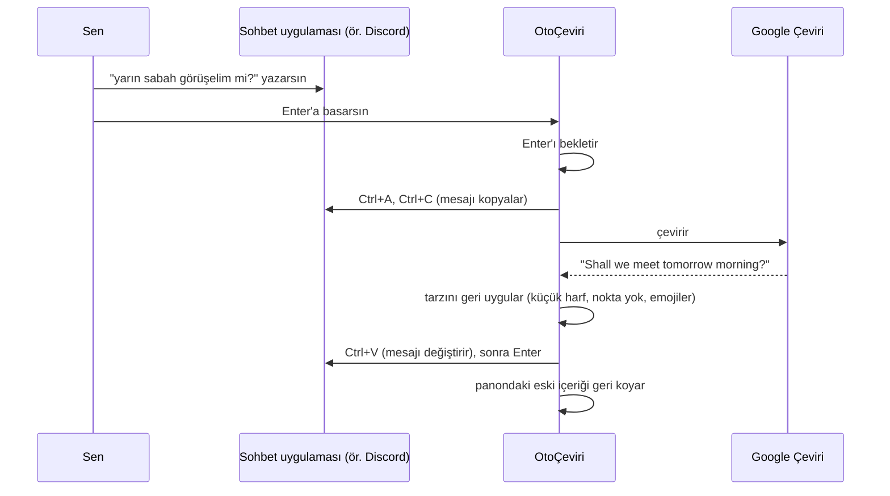

[English](README.md) | **Türkçe**

# OtoÇeviri

**Kendi dilinde yaz, onların dilinde gönder.** OtoÇeviri, klavyeyle yazdığın metni seçtiğin dile çeviren küçük bir Windows tepsi uygulamasıdır. Çeviri, yazdığın uygulamanın içinde gerçekleşir: Discord, WhatsApp, Telegram, tarayıcıdaki sohbetler, oyun içi sohbetler ve daha fazlası. Yazım tarzını bozmaz: küçük harfle yazdıysan çeviri de küçük harf kalır, sona nokta koymadıysan nokta eklenmez, emojiler koyduğun yerde durur.

```
Sen yazarsın:    merhaba, bu akşamki toplantıya katılabilecek misin? 🙂
Onlar görür:     hello, will you be able to attend the meeting tonight? 🙂
```

## İçindekiler

- [Özellikler](#özellikler)
- [Nasıl çalışır](#nasıl-çalışır)
- [Gereksinimler](#gereksinimler)
- [Kurulum](#kurulum)
- [Başlarken](#başlarken)
- [Kullanım](#kullanım)
- [Tarz koruma](#tarz-koruma)
- [Ayarlar](#ayarlar)
- [Kısayollar](#kısayollar)
- [Ayar dosyası](#ayar-dosyası)
- [Gizlilik ve güvenlik](#gizlilik-ve-güvenlik)
- [Sınırlamalar](#sınırlamalar)
- [Sorun giderme](#sorun-giderme)
- [Proje yapısı](#proje-yapısı)
- [Yol haritası](#yol-haritası)
- [Lisans](#lisans)
- [Sorumluluk reddi](#sorumluluk-reddi)

## Özellikler

- **Enter'a basınca çevir.** Mesajını yaz, Enter'a bas. Mesaj tek adımda çevrilir ve gönderilir.
- **Kısayolla çevir.** `Ctrl+Shift+U` seçili metni (ya da yazı kutusunun tamamını) olduğu yerde çevirir, göndermez.
- **Geri al.** Kısayolla çevirdikten hemen sonra `Ctrl+Shift+Z` ile orijinal metnine dönersin.
- **Tarzını korur.** Küçük harf, BÜYÜK HARF, sona konmayan nokta, emojiler ve satır sonları korunur.
- **Gereksiz çeviri yapmaz.** Bot komutları (`/play ...`), linkler, sadece emojiden oluşan mesajlar ve zaten hedef dilde olan metinler çevrilmez.
- **13 hedef dil:** İngilizce, Almanca, Fransızca, İspanyolca, İtalyanca, Portekizce, Felemenkçe, Rusça, Arapça, Japonca, Korece, Çince ve Türkçe. Kaynak dil otomatik algılanır.
- **Türkçe ve İngilizce arayüz.** Varsayılan olarak Windows'un dilini takip eder.
- **Açık, koyu ya da sistem teması.** Varsayılan olarak Windows temasını takip eder, uygulama açıkken tema değişse bile.
- **Windows açılışında başlatma** (isteğe bağlı). Yönetici izni gerekmez.
- **Ücretsiz.** Google Çeviri'nin herkese açık web adresini kullanır. API anahtarı ya da hesap gerekmez.

## Nasıl çalışır

OtoÇeviri sistem tepsisinde çalışır ve yalnızca iki şeyi dinler: Enter tuşunu ve kendi kısayollarını. Otomatik Çeviri açıkken bunlardan birine basıldığında şunları yapar:



Çeviri genellikle yaklaşık 0,3 saniye sürer.

## Gereksinimler

- Windows 10 ya da Windows 11
- Python 3.10 ya da daha yenisi (Python 3.13 ile geliştirildi ve test edildi)
- İnternet bağlantısı

## Kurulum

```bash
git clone https://github.com/ysft1rt-art/otoceviri.git
cd otoceviri
pip install -r requirements.txt
```

Kullanılan kütüphaneler: [`keyboard`](https://pypi.org/project/keyboard/) (sistem genelinde tuş yakalama), [`pyperclip`](https://pypi.org/project/pyperclip/) (pano), [`pystray`](https://pypi.org/project/pystray/) (tepsi simgesi) ve [`Pillow`](https://pypi.org/project/pillow/) (simgeyi çizmek için). Ayarlar penceresi Python'la birlikte gelen Tkinter'ı kullanır.

## Başlarken

1. **`baslat.bat`** dosyasına çift tıkla. Uygulama konsol penceresi açmadan başlar. İstersen `pythonw otoceviri.py` komutunu kendin de çalıştırabilirsin.
2. Saatin yanında, tepside küçük bir **Ç** simgesi belirir. Göremiyorsan `^` okunun arkasındaki gizli simgelere bak.
3. Otomatik Çeviri **kapalı** başlar ve simge **gridir**. Açmak için **`Ctrl+Shift+Y`**'ye bas ya da simgeye sol tıkla. Simge **yeşile** döner ve kısa, ince bir bip sesi duyarsın. Kapatınca daha kalın bir bip duyulur.
4. **Hedef dili** seçmek için simgeye sağ tıkla. Varsayılan dil İngilizce.
5. Bir sohbet aç, kendi dilinde yaz ve Enter'a bas.

Aynı anda uygulamanın yalnızca bir kopyası çalışabilir. İkinci kez açmaya çalışırsan "OtoÇeviri zaten çalışıyor." uyarısı çıkar.

## Kullanım

İki çeviri modu var. İkisi de varsayılan olarak açıktır. Her birini tepsi menüsünde ya da Ayarlar'da **Çeviri modu** altından ayrı ayrı açıp kapatabilirsin.

### Enter'a basınca otomatik çevir

Mesajını yaz ve **Enter**'a bas. OtoÇeviri yazı kutusunu kopyalar, çevirir, metni değiştirir ve Enter'a senin yerine basar.

- **Shift+Enter**'a (ve Ctrl/Alt/Win+Enter'a) hiç dokunulmaz. Yeni satır eklemeye devam edebilirsin.
- Metnin çevrilmesi gerekmiyorsa mesaj olduğu gibi gönderilir. Bu durumlar: bir komut, bir link, yalnızca emoji ya da zaten hedef dilde olan bir metin.
- Yazı kutusu boşsa ya da kopyalanamıyorsa (ör. şifre kutuları), Enter her zamanki gibi çalışır.
- **Çeviri başarısız olursa** (ör. internet yoksa) mesaj **gönderilmez**. Bir bildirim ve hata sesi gelir, metnin kutuda kalır. Tekrar denemek için Enter'a yeniden bas. Çevirmeden göndermek istersen Otomatik Çeviri'yi kapat.
- **Enter'ın başka bir anlamı olduğu programlarda** Enter modu devreye girmez: Word, Excel, PowerPoint, OneNote, Not Defteri, Notepad++, VS Code, Visual Studio, terminaller, Dosya Gezgini, Windows Arama ve şifre yöneticileri. Listeyi Ayarlar'dan düzenleyebilirsin. Kısayol modu bu programlarda da çalışır.

### Kısayol ile çevir

**`Ctrl+Shift+U`**'ya bas:

- Bir metin **seçiliyse** yalnızca seçili kısım çevrilip değiştirilir.
- **Hiçbir şey seçili değilse** yazı kutusunun tamamı çevrilir.
- Hiçbir şey gönderilmez, önce sonucu kontrol edebilirsin. Uzun metinlerde, e-postalarda ve belgelerde bu modu kullan.

### Son çeviriyi geri al

Kısayolla çevirdikten hemen sonra **`Ctrl+Shift+Z`**'ye basarsan orijinal metnin geri gelir.

- Güvenlik için OtoÇeviri, çevrilmiş metni imleçten geriye doğru seçer ve değiştirmeden önce **seçimin tam olarak o çeviri olduğunu doğrular**. Arada metni düzenlediysen ya da imleci taşıdıysan hiçbir şeye dokunmaz ve "Geri alınamadı: metin değişmiş" uyarısını gösterir.
- Geri alma **aynı pencerede** ve çeviriden sonraki **5 dakika** içinde çalışır.
- Geri alınacak bir şey yoksa `Ctrl+Shift+Z` her zamanki gibi programa gider. Birçok programda "yinele" anlamına gelir.
- Enter moduyla gönderilen mesajlar geri alınamaz, çünkü gitmiş olurlar.

### Kısayollar başka programlara karışmaz

OtoÇeviri'nin kısayolları yakalanır ve yazdığın programa ulaşmaz. Örneğin Discord'da `Ctrl+Shift+U` normalde dosya yükleme penceresini açar, ama OtoÇeviri bu kısayolu kullanırken açmaz. Başka programların işine karışmamak için:

- `Ctrl+Shift+Y` (aç/kapat) her zaman OtoÇeviri'ye aittir.
- `Ctrl+Shift+U` (çevir) yalnızca Otomatik Çeviri açıkken ve kısayol modu etkinken yakalanır.
- `Ctrl+Shift+Z` (geri al) yalnızca gerçekten geri alınacak bir çeviri varken yakalanır.

## Tarz koruma

Google Çeviri ilk harfi büyütür ve sen koymasan bile sona çoğu zaman nokta ekler. OtoÇeviri metni çevirir, sonra yazış alışkanlıklarını geri uygular. Aşağıdakiler gerçek sonuçlardır:

| Sen yazarsın | Google'ın düz çevirisi | OtoÇeviri gönderir |
|---|---|---|
| `yarın sabah görüşelim mi?` | `Shall we meet tomorrow morning?` | `shall we meet tomorrow morning?` |
| `Rapor hazır, inceleyebilirsiniz` | `The report is ready, you can review it.` | `The report is ready, you can review it` |
| `harika bir haber 🎉` | `Great news 🎉` | `great news 🎉` |

Kurallar:

- **Hep küçük harfle** yazdıysan çeviri de küçük harf olur. Türkçe I/ı ve İ/i doğru dönüştürülür. Kural çevirinin tamamına uygulanır, yani İngilizcede "I" zamiri de "i" olur. Bunu istemiyorsan mesajına büyük harfle başla.
- **BÜYÜK HARFLE** yazdıysan (en az 3 harf) çeviri de büyük harf olur. Google bunu genelde zaten yapar, OtoÇeviri garanti altına alır.
- **Sona noktalama koymadıysan** Google'ın eklediği nokta silinir. Soru ve ünlem işaretleri korunur.
- Mesajın başındaki ve sonundaki **emojiler** korunur. Ten rengi, aile emojileri ve bayraklar da buna dahil. Google emojileri genelde korur ama bazen sondakini düşürür, OtoÇeviri onu geri ekler.
- **Baştaki/sondaki boşluklar ve satır sonları** korunur.

Çeviriler Google'dan geldiği için aynı metin farklı zamanlarda biraz farklı çevrilebilir.

## Ayarlar

Tepsi simgesine sağ tıklayıp **Ayarlar…**'ı seç. Değişiklikler **Kaydet**'e bastığın anda uygulanır, yeniden başlatmaya gerek yoktur.

**Genel**

| Ayar | Ne yapar |
|---|---|
| Hedef dil | Metnin çevrileceği dil. Tepsi menüsünden de değiştirilebilir. |
| Arayüz dili | **Sistem** (varsayılan), **Türkçe** ya da **English**. Sistem seçiliyse, Windows'un görüntüleme dili Türkçe ise arayüz Türkçe, değilse İngilizce olur. Tepsi menüsü kaydeder kaydetmez değişir, Ayarlar penceresi ise bir sonraki açılışta yeni dilde açılır. |
| Tema | **Sistem** (varsayılan), **Açık** ya da **Koyu**. Sistem seçiliyse uygulama açıkken Windows uygulama temasını takip eder. Tema; Ayarlar penceresine, başlık çubuğuna ve tepsi menüsüne uygulanır. Bir temaya tıklayınca pencere hemen o temaya geçer. |
| Program açılınca Otomatik Çeviri açık başlasın | Uygulama varsayılan olarak Otomatik Çeviri kapalı başlar. |
| Windows açılışında başlat | Windows'ta oturum açınca OtoÇeviri'yi başlatır. Ayar yalnızca senin kullanıcı hesabına yazılır (`HKCU\...\Run`), yönetici izni gerekmez. Uygulama klasörünü taşırsan kayıttaki yol bir sonraki açılışta kendiliğinden düzelir. |

**Çeviri modu** (aynı anda yalnızca biri seçilebilir)

| Ayar | Ne yapar |
|---|---|
| Kısayol ile çevir | Seçili metni yalnızca kısayola (`Ctrl+Shift+U`) basınca çevirir. |
| Enter'a basınca otomatik çevir | Enter'a basınca metni çevirip gönderir. |

**Kısayollar**

**Değiştir**'e bas, sonra yeni tuş kombinasyonuna bas. İptal etmek için `Esc`'ye bas. Kısayolda **Ctrl, Alt ya da Win** tuşlarından biri olmalı, yoksa (ör. Shift+A) normal yazmayı engeller. Aynı kısayol iki işe atanamaz.

**Enter modunun çalışmayacağı programlar**

Her satıra bir program yaz, ör. `excel.exe`. Sonuna `.exe` yazmazsan otomatik eklenir. Bir programın adını öğrenmek için Görev Yöneticisi'ni aç, programa sağ tıkla ve **Ayrıntılara git**'i seç.

### Hakkında

Tepsi simgesine sağ tıklayıp **Hakkında**'yı seçersen sürüm numarasını, bu GitHub sayfasının bağlantısını, lisansı ve sorumluluk reddini görürsün. Kapatmak için `Esc`'ye, `Enter`'a ya da **Kapat**'a bas.

## Kısayollar

| İşlem | Varsayılan | Ne zaman çalışır |
|---|---|---|
| Otomatik Çeviri'yi aç/kapat | `Ctrl+Shift+Y` | Her zaman |
| Seçimi / yazı kutusunu çevir | `Ctrl+Shift+U` | Otomatik Çeviri açık ve kısayol modu etkinken |
| Son çeviriyi geri al | `Ctrl+Shift+Z` | Kısayolla çeviriden hemen sonra (aynı pencere, 5 dakika içinde) |
| Çevir ve gönder | `Enter` | Otomatik Çeviri açık ve Enter modu etkinken, hariç programlar dışında |
| Yeni satır (asla çevrilmez) | `Shift+Enter` | Her zaman |

## Ayar dosyası

Ayarlar, uygulamanın yanındaki **`ayarlar.json`** dosyasında saklanır. Dosya ilk açılışta oluşturulur ve Git'e eklenmez. Ayarları değiştirmenin en kolay yolu Ayarlar penceresi, ama uygulama kapalıyken dosyayı elle de düzenleyebilirsin:

| Anahtar | Varsayılan | Açıklama |
|---|---|---|
| `hedef_dil` | `"en"` | Hedef dil kodu: `en`, `de`, `fr`, `es`, `it`, `pt`, `nl`, `ru`, `ar`, `ja`, `ko`, `zh-CN`, `tr` |
| `arayuz_dili` | `"sistem"` | Arayüz dili: `sistem`, `tr`, `en` |
| `tema` | `"sistem"` | Tema: `sistem`, `acik`, `koyu` |
| `ceviri_modu` | `"enter"` | Çeviri modu: `enter` (Enter'a basınca çevir) veya `kisayol` (kısayol ile çevir) |
| `acilista_aktif` | `false` | Açılışta Otomatik Çeviri açık başlasın |
| `ac_kapa_kisayolu` | `"ctrl+shift+y"` | Aç/kapat kısayolu |
| `cevir_kisayolu` | `"ctrl+shift+u"` | Çevir kısayolu |
| `geri_al_kisayolu` | `"ctrl+shift+z"` | Geri al kısayolu |
| `enter_haric_programlar` | yukarıya bak | Enter modunun çalışmayacağı programlar (küçük harfli `.exe` adları) |

Geçersiz değerler varsayılana döner. "Windows açılışında başlat" bu dosyada değil, Windows kayıt defterinde tutulur.

## Gizlilik ve güvenlik

- **Bilgisayarından ne çıkar:** yalnızca çevirdiğin metin, HTTPS üzerinden Google Çeviri'ye gönderilir (`translate.googleapis.com`, olmazsa `translate.google.com`). Başka hiçbir yere hiçbir şey gönderilmez. Hesap, analiz ya da kullanım verisi toplama yoktur.
- **Ne saklanır:** yazdığın hiçbir şey kaydedilmez. `otoceviri.log` dosyasında **yalnızca hata mesajları** bulunur, metnin asla bulunmaz. `ayarlar.json`'da yalnızca ayarların durur.
- **Klavye kancası:** Enter'a ve kısayollara tepki verebilmek için OtoÇeviri sistem genelinde bir klavye kancası kurar. Tuş basımlarını **kaydetmez**. Metni yalnızca Enter'a ya da çeviri kısayoluna bastığın anda yazı kutusunu kopyalayarak okur. Klavye kancaları tuş kaydedicilerde de kullanıldığı için bazı antivirüs programları uygulamayı şüpheli bulabilir. Kaynak kodun tamamı burada, inceleyebilirsin.
- **Pano:** her çeviri sırasında panon kısa bir süre kullanılır ve hemen ardından eski haline getirilir. Yalnızca **metin** geri konur, panoda resim ya da dosya varsa kaybolur.
- **Şifre kutuları:** Windows şifre kutularından kopyalamaya izin vermez. Bu yüzden OtoÇeviri onları okuyamaz ve oralarda Enter normal çalışır. Şifre yöneticileri de varsayılan olarak hariç tutulan programlar listesindedir.

## Sınırlamalar

- **Yalnızca Windows'ta çalışır.**
- **Resmi olmayan adres:** Google'ın ücretsiz web adresi resmi bir API değildir. Google bu adresi haber vermeden sınırlayabilir, değiştirebilir ya da engelleyebilir.
- **Çeviri kalitesi** Google'ınkiyle sınırlıdır. Kısa ya da bağlamı az olan mesajlar tuhaf çevrilebilir. Örneğin "deneme" kelimesi "test" yerine "experiment" olabilir.
- **Yönetici olarak çalışan programlar** normal bir uygulamadan kontrol edilemez. Oralarda da kullanmak istiyorsan OtoÇeviri'yi de yönetici olarak çalıştır.
- **Hile koruması olan oyunlar** sahte tuş basımlarını engelleyebilir. Bazı oyun içi sohbetler de `Ctrl+A/C/V`'yi desteklemez.
- **Ctrl+A'nın mesajdan fazlasını seçtiği programlar** (belgeler, kod düzenleyiciler) Enter modunun hariç listesinde olmalı. Yaygın olanlar varsayılan olarak listede.
- Panoya yalnızca metin geri konur (yukarıya bak).

## Sorun giderme

**"Çeviri yapılamadı. İnternet bağlantını kontrol et."**
Çevirinin uygulama dışında çalışıp çalışmadığını dene:

```bash
python ceviri.py en "merhaba dünya"
```

Bu da başarısız olursa Google'a giden bağlantıyı bir güvenlik duvarı, VPN, proxy ya da antivirüsün HTTPS taraması engelliyor olabilir. OtoÇeviri bağlantıyı zaten IPv4 üzerinden kurar, çünkü bazı ağlarda Google'a IPv6 ile kurulan bağlantı TLS el sıkışmasında kopuyor.

**Enter'a basınca hiçbir şey olmuyor.**
Simgenin yeşil olduğundan (Otomatik Çeviri açık), Çeviri modu altında Enter modunun seçili olduğundan ve programın hariç listesinde olmadığından emin ol. Program yönetici olarak çalışıyorsa [Sınırlamalar](#sınırlamalar) bölümüne bak.

**Bir kısayol başka bir programla çakışıyor.**
Ayarlar → Kısayollar'dan başka bir kombinasyon seç.

**Geri alma "Geri alınamadı: metin değişmiş" diyor.**
Çeviriden sonra metin ya da imlecin yeri değişmiş. Programın kendi `Ctrl+Z`'sini kullan.

**Uygulama kapandı ya da garip davranıyor.**
Uygulama klasöründeki `otoceviri.log` dosyasına bak, içinde yalnızca hata ayrıntıları var. Bir issue açıp bu dosyayı ve **Hakkında** penceresindeki sürüm numarasını eklersen sevinirim.

## Proje yapısı

| Dosya | Görevi |
|---|---|
| `otoceviri.py` | Ana uygulama: tepsi simgesi, klavye kancaları, Enter/kısayol/geri alma mantığı |
| `ceviri.py` | Google Çeviri istemcisi (IPv4, yedek adres) ve tarz koruma. Test için tek başına çalıştırılabilir. |
| `ayarlar_penceresi.py` | Ayarlar penceresi |
| `hakkinda_penceresi.py` | Hakkında penceresi |
| `pencere.py` | Pencerelerin ortak kodu: Tkinter iş parçacığı ve temalı pencere temel sınıfı |
| `surum.py` | Sürüm numarası ve GitHub bağlantısı |
| `metinler.py` | Türkçe ve İngilizce arayüz metinleri |
| `kisayollar.py` | Kısayolları okuma, doğrulama ve gösterme |
| `tema.py` | Açık/koyu/sistem teması: renkler, başlık çubuğu, tepsi menüsü |
| `baslangic.py` | Windows açılışında başlatma (kayıt defteri) |
| `baslat.bat` | Uygulamayı konsol penceresi olmadan başlatır |
| `requirements.txt` | Python bağımlılıkları |

**Yeni bir arayüz dili eklemek için:** `metinler.py` içindeki `METINLER` ve `DIL_ADLARI`'na, mevcut dillerle aynı anahtarlara sahip yeni bir blok ekle. Sonra dil kodunu `ARAYUZ_DILLERI`'ne, dilin kendi dilindeki adını da `ARAYUZ_DILI_ADLARI`'na ekle.

## Yol haritası

- Tek başına çalışan `.exe` (Python kurulumu gerektirmeden)
- Gelen mesajları okuma: yabancı dildeki bir mesajı seç, kendi dilinde gör
- Programa göre farklı hedef dil (ör. Discord'da İngilizce, WhatsApp'ta Almanca)
- Bağlamı daha iyi anlayan, daha doğal çeviriler yapan isteğe bağlı bir yapay zeka çeviri motoru

## Lisans

OtoÇeviri [MIT Lisansı](LICENSE) ile yayınlanmıştır. Telif hakkı ve lisans bildirimini korumak şartıyla, ticari projeler dahil serbestçe kullanabilir, kopyalayabilir, değiştirebilir ve paylaşabilirsin. Yazılım hiçbir garanti olmadan sunulur.

## Sorumluluk reddi

OtoÇeviri bağımsız bir projedir. Google ile bir bağlantısı yoktur, Google tarafından onaylanmamış ya da desteklenmemiştir. "Google Translate", Google LLC'nin ticari markasıdır. Ücretsiz web adresi kişisel ve ticari olmayan kullanım için kullanılır. Sorumlu bir şekilde ve kendi sorumluluğunda kullan.
